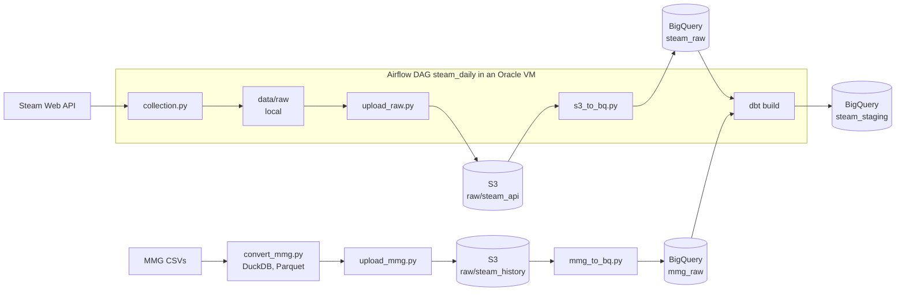

# Steam Price Observatory

A daily ELT pipeline that builds price and player count history for 784 Steam
titles from an API that only returns present prices.

Steam's Web API tells you what a game costs currently. It has no endpoint for
price history and the public bulk datasets are snapshots. This
project collects daily observations and models them as slowly changing dimensions,
producing a dataset that cannot be obtained any other way.

**Stack:** Python · BigQuery · dbt Core · S3 · Airflow · Docker · Oracle Cloud · GitHub Actions · DuckDB · Parquet

The daily run is orchestrated by Airflow on an Oracle Cloud VM, see [orchestration](#orchestration).
Every change passes CI before it reaches `main`, and the VM deploys `main` by itself, see [CI/CD](#cicd).

## Architecture



| Layer                              | What it does                                                  |
| ---------------------------------- | ------------------------------------------------------------- |
| `collection.py`                    | Polls Steam for the working set and writes raw JSONL          |
| `upload_raw.py`                    | syncs the collected daily and saved api called titles to S3   |
| `s3_to_bq.py`                      | Loads JSONL into BigQuery, incrementally (idempotent);        |
| `convert_mmg.py` / `upload_mmg.py` | Conversion of the historical CSVs to Parquet and upload to S3 |
| `mmg_to_bq.py`                     | Loads the historical Parquets into BigQuery `mmg_raw` from S3 |
| `models/staging/`                  | Parses JSON, casts types, derives `price_status`              |
| `snapshots/`                       | SCD Type 2 history of price changes                           |
| `models/marts/`                    | Analytics-ready tables                                        |
| `seeds/app_ids.csv`                | The selected tracked appids and how each app was selected     |
| `tests/`                           | Custom data tests                                             |
| `orchestration/`                   | Astro project with the Airflow DAG and the image              |

## Data sources

| Source                     | Role                  | Notes                            |
| -------------------------- | --------------------- | -------------------------------- |
| Steam `appdetails`         | Daily price snapshots | Public API to fetch app details  |
| Steam `GetMostPlayedGames` | Daily concurrents     | Top 100 results                  |
| Steam Dataset 2025         | Historical backfill   | 239,664 apps - 1,048,148 reviews |

784 apps collected on 2026-09-09 and stored as the dbt seed `app_ids.csv` with the source each app
was selected from:

| Source                                       | Apps  | What it is                                                      |
| -------------------------------------------- | ----- | --------------------------------------------------------------- |
| `mmg_top_paid`                               | 583   | Paid USD titles with the most reviews in the historical dataset |
| `charts_top100`                              | 101   | Steam's most-played                                             |
| `featured_new_releases`                      | 59    | Store front page                                                |
| `featured_coming_soon`                       | 20    | Store front page                                                |
| `watchlist`                                  | 11    | Hand-picked                                                     |
| `featured_top_sellers` / `featured_specials` | 5 / 5 | Store front page                                                |

The historical dataset caps reviews at
100 per app with over 2,000 apps at the cap and the lowest appid decided the selection, meaning older titles. Across the whole set 65% were released in 2017 or earlier (median release year 2016).

When fetching, 782 of the 784 titles are collectable. 560710 was delisted between the dataset's snapshot and selection
and 1746527 is a bundle id and not an appid because the selection script did not filter item types.

## Data quality findings

Notes from exploring the sources before modelling. Several of these changed the
design.

### The historical dataset covers 56% of Steam's catalogue

Steam's app list contains far more than games like DLC, demos, soundtracks, videos
and playtests that all have IDs. The upstream collection called `appdetails` on every
one of them and about 44% returned nothing, mostly because the content was
delisted or region-restricted. Delisted titles tend to be older ones, which means release
counts by year have a recency bias.

### Steam prices are not currency-convertible

The historical data contains 32 currencies. Valve uses **regional pricing tiers**
rather than exchange-rate conversion. That means that a title at $19.99 in the US may be ₹999 (~$10.5) in
India, cross-currency aggregation is therefore invalid.
This pipeline filters to `USD` (because of a 98.6% coverage on the historical dataset) and collects
with `cc=us` pinned, so both sources share one currency with dbt tests to make sure the source is USD.

### Review volume spikes 9x in 2025

Reviews average ~5,750/month in 2024 and ~54,000/month in 2025. The collector used the review endpoint's default
most recent first ordering, so recent reviews are heavily over-sampled and **thus** no marts that calculate review volume over time have merit. The `steam_purchase` flag is also constant `true` across all
1,048,148 rows, which indicates that all reviews come from verified purchases only.

### Integer columns were written as floats

Integer columns in the historical CSVs that contain NULLs were written as floats `999.0`
. In BigQuery `safe_cast('999.0' as int64)` returned NULL (When DuckDB TRY_CAST did not have that problem) and it
turned all 144,923 prices into NULL without an error. That is why `to_int` and `cast_preserves_values` were created, casting as numeric first and then checking that the number of non-empty raw values equals the number of non-null staged values on every cast column.

### The value `price_status`

A null price does not mean only one thing:

| Status         | Cause                                                      |
| -------------- | ---------------------------------------------------------- |
| `priced`       | Normal paid title                                          |
| `free`         | `is_free: true`, no price block in the response            |
| `unreleased`   | `coming_soon: true` — not yet purchasable                  |
| `fetch_failed` | API returned `success: false`                              |
| `unpriced`     | Free-to-play without the flag, delisted, non-game listings |

Failed fetches are **stored as rows** for transparency.

The status `unpriced` is a mixed bucket:  
Rocket League has moved to Epic and delisted, Shogun 2's appid has been superseded by another, Call of Duty has a button redirect, FiveM is an advertisement, so no prices can be derived from these appid endpoints.

### Other source defects of the historical source

- `required_age` contains `17+` and scrape artifacts alongside integers
- `votes_funny` maxes at 4,294,967,295 (2<sup>32</sup>−1), an overflow
- `release_date` includes `1969-12-31` (epoch-zero parse failures), `9998` and `6969`
- `created_at` / `updated_at` hold the dump generation time so they can't be used for the data structure
- The Hugging Face comparison set encodes missing values as `""` rather than `NULL`,
  so null-rate tests are meaningless against it
- `tags` and `movies` are empty arrays throughout that set

These defects are kept as they are in raw and handled in staging.

### Retired endpoints

A big limitation is that useful public endpoints that can be used to query the steam api are
not maintained or retired, for example `ISteamApps/GetAppList/v2`
that directs users to `IStoreService/GetAppList` that requires a steam API key, but
has a useful `last_modified` for
change-data-capture.

### Steam changed its response key for three days

From 2026-09-25 to 2026-09-27, `appdetails` returned the correct body for 419 of the 784 apps
but under a different key (e.g. a request for appid `440` came back `629330` which is one of its
DLC ids). The collector had just been changed
to label a missing key explicitly as `not_in_response` instead of storing `{}`, so the change
counted 419 as fetch failures on the first day instead of 419 rows classified `unpriced`.
The collector now takes the single entry and records the unexpected key as
`_response_key`. The behaviour stopped on 2026-09-28.

### Player-count rollups

`GetMostPlayedGames` reports the previous UTC day and not the day of collection. On 2026-09-16 Steam
returned the 2026-09-14 response again with a broken ranking (#1 at 42,617 peak players, where CS2
normally exceeds 1.2M) and 2026-09-15 was never recorded.

## Design decisions

### Incremental load file by file from S3

Raw files are uploaded to S3 before anything is loaded with `s3_to_bq.py`.
It loads only the files that exist in S3 and not yet in BigQuery.
A rerun finds nothing new, so the load is **idempotent**.
Each table is appended in one load job which is applied atomically.

This replaced a full reload from the local folder with (`WRITE_TRUNCATE`).
Losing the local data for some reason would have dropped them from BigQuery and they could not be re-fetched,
now the model is completely independent from local files.

`--full-refresh` rebuilds both tables from S3 for schema changes and raises an exception if BigQuery has files that S3 does not as to not lose data.
`--dataset` loads into another dataset for testing purposes.

### Raw JSON stored whole and `response_json` is stored as a string

In `collection.py` the complete API response is stored as a string
and parsed in dbt. The native `JSON` BigQuery type rejects malformed values at load time, which would contradict
storing failures as data and since we can not reconstruct not collected fields, `JSON_VALUE()` is used.

### A failed fetch is represented as a gap

Failed fetches are stored and staged as rows but `fct_price_history` and the snapshot input
(`stg_prices_current`) do not include them. If they did, a bad day would produce two false versions per app
(priced → fetch_failed → priced). Delisting leaves the last price open.

### Price history vs snapshot

`fct_price_history` is an SCD Type 2 table built from every successful observation in raw that can be dropped and rebuilt at any time so more reliable from a snapshot which may miss some days because it is dependent on not missing a build run like `snap_prices`. Here both are kept for comparison and to show the
mechanism, since the data does not overwrite itself.

### First file wins for player-count days

A rollup day is published once, so `fct_player_peaks` keeps the first file that reported each day.
Made `rollup_check` to check for duplicate days due to the double day on the 16th and
`100_a_day` checks that every rollup day has exactly 100 rows. Since the double day rectification left 147 rows with some duplicates by mistake, a test was created to account for that.

### `dt=` means different things in S3

Under `raw/steam_api/`, `dt` is the UTC **observation** date parsed from the run timestamp in the
file name, so a catch-up run is uploaded correctly. In `raw/steam_history/`,
`dt` is the **ingest** date of the download, only for versioning of the dataset.

### Why both S3 and BigQuery

Single cloud on GCS would be simpler and cheaper since BigQuery can query Parquet on GCS. S3
was chosen deliberately to build with both providers. It has a bit more setup with a transfer script
(`mmg_to_bq.py`) and two IAM models. The benefit is though that the raw zone is safe in S3 even if the
project in GCP is deleted or misconfigured. At ~265 MB the cost of the implementation is negligible.

### Partitioning and clustering

`mmg_raw.reviews` (1.05M rows) is partitioned by **month** on `timestamp_created` and clustered on
`appid`. Monthly was selected because daily partitions would be 5,216 partitions with a median of 134 rows and yearly would put
42.5% of rows in 2025. Monthly gives 180 partitions.

Measured on the reviews table:

| Query                           | Unpartitioned | Partitioned / clustered |
| ------------------------------- | ------------- | ----------------------- |
| `SELECT * … LIMIT 10`           | 655.39 MB     |                         |
| 3 columns                       | 22.23 MB      |                         |
| 3 columns, one month            | 22.23 MB      | **107 KB**              |
| 3 columns, `appid = 730`        | 22.23 MB      | **513 KB**              |
| 3 columns, the 784 tracked apps | 22.23 MB      | 22.23 MB                |

- Selecting columns is the biggest saving −96.6%
- A filter saves nothing on an unpartitioned table
- Clustering helps for one app but not all since the appids are spread over
  the whole id range

`steam_raw.raw_prices` was created without partitioning and was migrated to day
partitions on `collected_at`, clustered on `appid` (`infra/migrations/2026-10-10_partition_raw_prices.sql`).
The same filter improved to **30.84 MB** from **529.31 MB**.

### Incremental models

Staging started as views because the parsing logic was still changing and the data was small. As the data grew the expensive models were made incremental.

| Daily dbt build | Before (view)                  | After (incremental) |
| --------------- | ------------------------------ | ------------------- |
| bytes processed | ~3,700 MiB growing ~110 MB/day | ~150 MiB, flat      |
| bytes billed    | ~4,200 MiB                     | 684 MiB             |

That is as close as the save can get with BigQuery's 10 MB minimum per query.

For **`fct_reviews`**, MMG is a static dateset, so new data arrival was **simulated** with
`reviews_as_of`. The model uses `insert_overwrite` on month partitions and when
incremental it re-reads from the start of the newest month.
`review_text` (82% of the bytes) is left out.

## Orchestration

The four steps run as the Airflow DAG `steam_daily` (`orchestration/dags/steam_daily.py`) on an
Oracle Cloud Linux VM. Airflow 3.3 runs from an Astro Runtime image with
the Astro CLI, replacing a Windows Task Scheduler job.

```
collection >> upload_raw >> s3_to_bq >> dbt_build
```

A failed task stops everything after it upstream_failed, the same as `run.bat`.
Retries are safe because `upload_raw.py` and `s3_to_bq.py` are idempotent and a rerun
of `collection.py` only adds another observation for the day, which the models already handle.

### The image and the repo

The image is pinned to `runtime:3.3-9-python-3.13`, the same Python as local development. The
pipeline scripts and dbt get their own venv inside the image so their pinned
versions never conflict with Airflow's dependencies. Tasks call that venv's `python` and `dbt` directly.

The repo is bind-mounted into the scheduler container and every task runs from the repo root.
`data/raw` is mounted and survives restarts.

### dbt in Airflow

dbt runs with `dbt deps && dbt build`. The build takes approx. 30 seconds and
`dbt build` already skips everything downstream of a failed test while finishing the unrelated
models, `dbt retry` reruns only what failed, so something like [Cosmos](https://github.com/astronomer/astronomer-cosmos) for example would not be that useful.

The DAG writes dbt artifacts to `target_airflow/` and `logs_airflow/`,because while developing locally across Linux and Windows they can corrupt each other's partial-parse cache if they share a `target/` folder.

### Credentials

| Cloud    | How                                                | Scope                                                                                                         |
| -------- | -------------------------------------------------- | ------------------------------------------------------------------------------------------------------------- |
| BigQuery | Service account `airflow-pipeline` with a key file | `bigquery.jobUser` on the project, `dataEditor` on `steam_raw` and `steam_staging`, `dataViewer` on `mmg_raw` |
| S3       | The repo's `.env`, read by `load_dotenv()`         | The IAM user's bucket policy (`infra/s3_user_pol.json`)                                                       |

`steam/profiles.yml` uses `method: oauth`, so dbt takes the same
Application Default Credentials as the scripts. The project id comes from the `GCP_PROJECT` environment variable.

Keyless options like Workload Identity Federation are not available to a
VM outside GCP so a key was needed. Note that Google enforces a secure-by-default policy that blocks key creation so it needs to be overriden for this project to work.

### Oracle's VM

- Oracle's network firewall allows only SSH but remote-ssh through VS Code makes development easier.
- An appropriate host group needs to be setup with astro to give read access to the key and
  write access to the repo.
- The containers restart with Docker after a reboot. A run missed during downtime
  starts as soon as the scheduler is back.
- The VM holds a read-only clone and no git credentials. Deployment is pull-based ([CI/CD](#cicd)).

## CI/CD

### Continuous Integration

`.github/workflows/ci.yml` runs on every pull request and every push to `main`.

| Job                             | Checks                                                                                                          | Cloud access |
| ------------------------------- | --------------------------------------------------------------------------------------------------------------- | ------------ |
| DAG tests and requirements sync | Making sure the root and the image's reqs match and steam_daily keeps schedule, catchup, retries and task order | None         |
| dbt build                       | It builds on the real raw data and writes to a dedicated ci dataset                                             | WIF          |

A ruleset for no direct or force pushes is enforced on main and a pull request
merges only when both the above checks pass. Pull requests are squash-merged.

### Keyless BigQuery access

The dbt job uses Workload Identity Federation, GitHub does not store a key.

1. GitHub gives the job a short-lived OIDC token that states which repository it runs for.
2. A workload identity provider in GCP trusts GitHub's issuer and accepts only tokens from this repository.
3. Only that repository can act as the service account with the `ci-dbt` and Google returns a 1 hour access token.

CI reads the production raw data but can only write to the `steam_ci` dataset whose tables expire after 7 days.
The `ci` target caps every query at 5 GB billed. The dbt job is skipped for pull requests from forks.

### Continuous Delivery

Deployment is pull-based. A systemd timer on the VM runs `orchestration/deploy/pull-deploy.sh`
every 5 minutes.

- It git fetches and compares with origin/main. If nothing is new, it exits.
- If a `steam_daily` run is queued or running, it waits for the next tick, so a run never mixes two versions of the code and a restart never kills a running task.
- `git merge --ff-only` refuses if the clone on the VM has diverged from `main`.
- `astro dev restart` runs only when files baked into the image change.

GitHub has no credentials for the VM and vice versa.

The one time installation on the VM:

```bash
sudo cp orchestration/deploy/steam-deploy.{service,timer} /etc/systemd/system/
sudo systemctl daemon-reload && sudo systemctl enable --now steam-deploy.timer
journalctl -u steam-deploy.service -n 20 --no-pager
```

The service reads `GCP_PROJECT` and `SECRETS_DIR` from `~/.config/steam-pipeline.env`.

## Tests

Besides `not_null` / `unique`:

| Test                                   | Guards                                       |
| -------------------------------------- | -------------------------------------------- |
| `cast_preserves_values` (generic)      | casts that turn values into NULL             |
| `not_negative` (generic)               | negative prices check                        |
| `accepted_values` `USD` on `currency`  | Steam ignoring `cc=us`                       |
| `accepted_range` 1–100 on `chart_rank` | out-of-range values                          |
| `unique_combination_of_columns`        | check grain logic, one row per x             |
| `100_a_day`                            | 100 chart rows a day                         |
| `rollup_check`                         | two files reporting the same day differently |

## Known limitations and design choices

- **One VM**  
  If the VM is down at 12:00 UTC the run starts when it is back, if it is down for the whole day that
  day is never collected. S3 and BigQuery hold all the data, so losing the VM loses no history and
  it can be rebuilt from git. It is also subject to Oracle's terms.
- **The BigQuery key for the VM is long-lived**  
  Mitigated by least-privilege roles, a read-only mount into one container and periodic rotation.
- **`collection` hands files to `upload_raw` through local disk**  
  Fine with the Local Executor since both run in the same container but with a distributed executor the
  two steps would have to be merged or the file would have to go to S3 directly.
- **The snapshot only sees days when dbt runs**  
  `fct_price_history` is built from every days observation, the snapshot has no entry for 2026-10-01 because dbt failed to build that day.
- **Changing the logic of an incremental model needs `--full-refresh`**  
  On logic changes the incremental model will have inconsistencies, with prior data representing different logic than new ones. It needs full refresh to apply the changes for all data on the model.
- **`source` in `app_ids.csv` is tagged by first match**  
  Some apps in the top paid list for example are tagged `charts_top100` because they were first met there. That means the column cannot be used to answer questions _"How do top-paid titles behave?"_ since some are tagged elsewhere.
- **Apps are frozen at selection time**  
  The tracked apps are fixed. More can be added, but the daily records of the new entries will start at selection date thereafter.
- **One observation per day**  
  Price changes that start and
  end between two runs are invisible.
- **`list_price` is the price of whichever purchase option Steam shows**  
  `appdetails` returns one `price_overview` per app and it switches between the base game,
  other editions and bundles. In the tracked set it showed a discounted edition or bundle
  whenever the base game was not discounted. A switch looks like a price change. All 7 list
  price changes across the October sale were switches. 23 of 1,283 price versions (1.8%) in 11 apps,
  are switches in the data as well.
- **No automatic rollback**  
  A merged change that breaks at run time still deploys so there would need to be a revert pull request.
  CI catches import errors, broken DAG settings and failing dbt builds before the merge.

## Results

### The October sale

| Period                              | Discounted     | Average discount |
| ----------------------------------- | -------------- | ---------------- |
| 9–21 Sep                            | ~20%           | 46–62%           |
| 22–28 Sep (after a promotion ended) | ~12%           | ~72%             |
| 29 Sep – 1 Oct (pre-sale)           | 10.5%          | ~71%             |
| 2–8 Oct (sale)                      | **65.3–65.8%** | 65.7–65.9%       |
| 9 Oct (day after)                   | 8.3%           | 65.0%            |
| 10 Oct                              | 9.0%           | 62.6%            |

The sale ran from the 1st to the 8th of October. Between 473 and 476 apps were discounted on every
day of it at the same average discount, so the discounts were set once for the whole week and
barely changed.

| Group                       | 28 Sep | 2 Oct (sale)        | 10 Oct |
| --------------------------- | ------ | ------------------- | ------ |
| `charts_top100` (66 priced) | 4.5%   | 80.3% (avg 48% off) | 15.2%  |
| `mmg_top_paid` (575 priced) | 15.0%  | 71.3% (avg 69% off) | 8.5%   |
| new releases (49 priced)    | 0%     | 2.0%                | 4.2%   |

The average discount fell when the sale started because ~400 smaller discounts joined a
group of long-running ones.

Steam's rules put a 30-day cooldown on discounts after a standard discount and seasonal sales are
exempt from it. An app whose own promotion ended shortly before the sale could join the sale
but not discount again right after it. The data is consistent with this, seeing as of the 61 apps whose
discount ended on 22 September, 3 (4.9%) were discounted on 10 October.
The most-played titles went the other way, from 4.5% before the sale to 15.2% after it.

Of the 721 apps that were priced during the sale, 7 changed list price (4 up, 3 down).
None of them was a re-pricing. In every case the purchase option Steam showed had changed.
Borderlands 2 and 3 and Golf With Your Friends showed a discounted edition before the sale and
the base game during it, and after the sale FlatOut 2, Marvel's Midnight Suns, Clair Obscur and
GTA V Enhanced switched to a discounted edition or bundle. FlatOut 2, for example, seemed to go
from $9.99 to $39.99, but the store still sold the game at $9.99, the $39.99 was the FlatOut
Complete Pack at 80% off.

## Setup

Requires Python 3.13, a GCP project with BigQuery (location `EU`), an S3 bucket and dbt Core with the
BigQuery adapter. Orchestration additionally needs Docker and the
[Astro CLI](https://www.astronomer.io/docs/astro/cli/install-cli).

```powershell
python -m venv venv; venv\Scripts\activate
pip install -r requirements.txt
copy .env.example .env
cd steam; dbt deps
```

Two environment variables are needed wherever dbt or Airflow run:

| Variable      | Used by                                    | Value                                                              |
| ------------- | ------------------------------------------ | ------------------------------------------------------------------ |
| `GCP_PROJECT` | `steam/profiles.yml`, the compose override | The GCP project id                                                 |
| `SECRETS_DIR` | The compose override                       | Folder holding the service account key `gcp-airflow-pipeline.json` |

## Running

### Airflow (prod on VM, or local)

```bash
cd orchestration
astro dev start                     # builds the image and starts Airflow
docker exec <scheduler container> airflow tasks test steam_daily dbt_build   # run one task without recording it
```

The DAG is paused on creation. On the VM the UI is reached through an SSH tunnel,
`ssh -N -L 8081:localhost:8080 <vm>`. Changes to the
`Dockerfile` or the requirements need `astro dev restart` to rebuild the image. On the VM the deploy script does this.

### Without Airflow

`run.bat` activates the venv and runs the four steps in order, stopping at the first one
that fails:

```Powershell
  python collection.py      # fetch prices and charts from Steam
  python upload_raw.py      # sync new raw files to S3
  python s3_to_bq.py        # load new S3 files into steam_raw
  cd steam; dbt build       # models, snapshot and tests
```

## Attribution

The historical data from [Steam Dataset 2025](https://doi.org/10.5281/zenodo.17266922) by Donald Fountain.  
Steam data retrieved via the public [Steam Web API](https://steamcommunity.com/dev).
