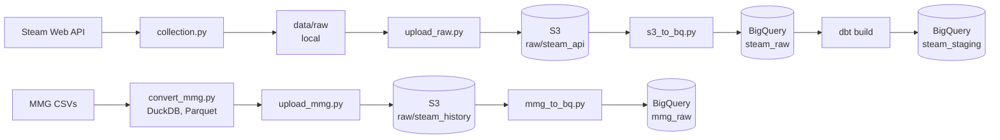

# Steam Price Observatory

A daily ELT pipeline that builds price and player count history for 784 Steam
titles from an API that only returns present prices.

Steam's Web API tells you what a game costs currently. It has no endpoint for
price history and the public bulk datasets are snapshots. This
project collects daily observations and models them as slowly changing dimensions,
producing a dataset that cannot be obtained any other way.

**Stack:** Python · BigQuery · dbt Core · S3 · DuckDB · Parquet

<!-- · Airflow · GitHub Actions -->

## Architecture

| Layer             | What it does                                                |
| ----------------- | ----------------------------------------------------        |
| `collection.py`   | Polls Steam for the working set and writes raw JSONL        |
| `s3_to_bq.py`     | Loads JSONL into BigQuery, incrementally (idempotent)       |
| `upload_raw.py`   | syncs the collected daily and saved api called titles to S3 |
| `convert_mmg.py` / `upload_mmg.py` | Convertion of the historical CSVs to Parquet and upload to S3 |
| `mmg_to_bq.py`    | Loads the historical Parquets into BigQuery `raw_mmg` from S3  |
| `models/staging/` | Parses JSON, casts types, derives `price_status`            |
| `snapshots/`      | SCD Type 2 history of price changes                         |
| `models/marts/`   | Analytics-ready tables                                      |
| `seeds/app_ids.csv` | The selected tracked appids and how each app was selected |
| `tests/` | Custom data tests |

## Data sources

| Source                     | Role                  | Notes                            |
| -------------------------- | --------------------- | -------------------------------- |
| Steam `appdetails`         | Daily price snapshots | Public API to fetch app details  |
| Steam `GetMostPlayedGames` | Daily concurrents     | Top 100 results                  |
| Steam Dataset 2025         | Historical backfill   | 239,664 apps - 1,048,148 reviews |

784 apps colelcted on 2026-09-09 and stored as the dbt seed `app_ids.csv` with the source each app
was selected from:
 
| Source | Apps | What it is |
| --- | --- | --- |
| `mmg_top_paid` | 583 | Paid USD titles with the most reviews in the historical dataset |
| `charts_top100` | 101 | Steam's most-played |
| `featured_new_releases` | 59 | Store front page |
| `featured_coming_soon` | 20 | Store front page |
| `watchlist` | 11 | Hand-picked |
| `featured_top_sellers` / `featured_specials` | 5 / 5 | Store front page |
 
The historical dataset caps reviews at
100 per app with over 2,000 apps at the cap and the lowest appid decided the selection, meaning older titles. Across the whole set 65% were released in 2017 or earlier (median release year 2016).
 
When fetching, 782 of the 784 titles are collectable. 560710 was delisted between the dataset's snapshot and selection
and 1746527 is a bundle id and not an appid because the selection script did not filter item types.

## Data quality findings

Notes from exploring the sources before modelling. Several of these changed the
design.

### The historical dataset covers 56% of Steam's catalogue

Steam's app list contains far more than games like DLC, demos, soundtracks, videos
and playtests that all have IDs. The upstream collection called `appdetails` on every
one of them and about 44% returned nothing, mostly because the content was
delisted or region-restricted. Delisted titles tend to be older ones, which means release
counts by year have a recency bias.

### Steam prices are not currency-convertible

The historical data contains 32 currencies. Valve uses **regional pricing tiers**
rather than exchange-rate conversion. That means that a title at $19.99 in the US may be ₹999 (~$10.5) in
India, cross-currency aggregation is therefore invalid.
This pipeline filters to `USD` (because of a 98.6% coverage on the historical dataset) and collects
with `cc=us` pinned, so both sources share one currency.

### Review volume spikes 9x in 2025

Reviews average ~5,750/month in 2024 and ~54,000/month in 2025. The collector used the review endpoint's default
most recent first ordering, so recent reviews are heavily over-sampled and **thus** no marts that calculate review volume over time have merit. The `steam_purchase` flag is also constant `true` across all
1,048,148 rows, which indicates that all reviews come from verified purchases only.

### The value `price_status`

A null price does not mean only one thing:

| Status         | Cause                                                      |
| -------------- | ---------------------------------------------------------- |
| `priced`       | Normal paid title                                          |
| `free`         | `is_free: true`, no price block in the response            |
| `unreleased`   | `coming_soon: true` — not yet purchasable                  |
| `fetch_failed` | API returned `success: false`                              |
| `unpriced`     | Free-to-play without the flag, delisted, non-game listings |

Failed fetches are **stored as rows** for transparency.

The status `unpriced` is a mixed bucket:  
Rocket League has moved to Epic and delisted, Shogun 2's appid has been superseded by another, Call of Duty has a button redirect, FiveM is an advertisement, so no prices can be derived from these appid endpoints.

### Other source defects of the historical source

- `required_age` contains `17+` and scrape artifacts alongside integers
- `votes_funny` maxes at 4,294,967,295 (232−1), an overflow
- `release_date` includes `1969-12-31` (epoch-zero parse failures), `9998` and `6969`
- The Hugging Face comparison set encodes missing values as `""` rather than `NULL`,
  so null-rate tests are meaningless against it
- `tags` and `movies` are empty arrays throughout that set

### Retired endpoints

A big limitation is that useful public endpoints that can be used to query the steam api are
not maintained or retired, for example `ISteamApps/GetAppList/v2`
that directs users to `IStoreService/GetAppList` that requires a steam API key, but
has a useful `last_modified` for
change-data-capture.

### Steam changed its response key for three days
 
From 2026-09-25 to 2026-09-27, `appdetails` returned the correct body for 419 of the 784 apps
but under a different key (e.g. a request for appid `440` came back `629330` which is one of its
DLC ids). The collector had just been changed
to label a missing key explicitly as `not_in_response` instead of storing `{}`, so the change
counted 419 as fetch failures on the first day instead of 419 rows classified `unpriced`.
The collector now takes the single entry and records the unexpected key as
`_response_key`. The behaviour stopped on 2026-09-28.

### Player-count rollups
 
`GetMostPlayedGames` reports the previous UTC day and not the day of collection. On 2026-09-16 Steam
returned the 2026-09-14 response again with a broken ranking (#1 at 42,617 peak players, where CS2
normally exceeds 1.2M) and 2026-09-15 was never recorded.
 
## Design decisions

### Incremental load file by file from S3

Raw files are uploaded to S3 before anything is loaded with `s3_to_bq.py`. 
It loads only the files that exist in S3 and not yet in BigQuery.
A rerun finds nothing new, so the load is **idempotent**.
Each table is appended in one load job which is applied atomically.

This replaced a full reload from the local folder with (`WRITE_TRUNCATE`). 
Losing the local data for some reason would have dropped them from BigQuery and they could not be re-fetched,
now the model is completely independent from local files.

`--full-refresh` rebuilds both tables from S3 for schema changes and raises an exception if BigQuery has files that S3 does not as to not lose data.

### Raw JSON stored whole and `response_json` is stored as a string

In `collection.py` the complete API response is stored as a string
and parsed in dbt. The native `JSON` BigQuery type rejects malformed values at load time, which would contradict
storing failures as data and since we can not reconstruct not collected fields, `JSON_VALUE()` is used.

### A failed fetch is represented as a gap
 
Failed fetches are stored and staged as rows but `fct_price_history` and the snapshot input
(`stg_prices_current`) do not include them. If they did, a bad day would produce two false versions per app
(priced → fetch_failed → priced). Delisting leaves the last price open.
 
### First file wins for player-count days
 
A rollup day is published once, so `fct_player_peaks` keeps the first file that reported each day.
Made `rollup_check` to check for duplicate days due to the double day on the 16th.
 
### `dt=` means different things in S3
 
Under `raw/steam_api/`, `dt` is the UTC **observation** date parsed from the run timestamp in the
file name, so a catch-up run is uploaded correctly. In `raw/steam_history/`,
`dt` is the **ingest** date of the download, only for versioning of the dataset.
 
### Why both S3 and BigQuery
 
Single cloud on GCS would be simpler and cheaper since BigQuery can query Parquet on GCS. S3
was chosen deliberately to build with both providers. It has a bit more setup with a transfer script
(`mmg_to_bq.py`) and two IAM models. The benefit is though that the raw zone is safe in S3 even if the
project in GCP is deleted or misconfigured. At ~265 MB the cost of the implementation is negligible.
 
### Partitioning and clustering
 
`mmg_raw.reviews` (1.05M rows) is partitioned by **month** on `timestamp_created` and clustered on
`appid`. Monthly was selected because daily partitions would be 5,216 partitions with a median of 134 rows and yearly would put
42.5% of rows in 2025. Monthly gives 180 partitions.

## Known limitations and design choices

- **Collection runs locally**  
  The collection happens by a local scheduled task that is subject to errors. It will be updated once Workload Identity Federation with Github Actions and orchestration with Airflow is set up.
- **The snapshot only sees days when dbt runs**  
 `fct_price_history` is built from every days observation, the snapshot has no entry for 2026-10-01 because dbt failed to build that day.
- **`source` in `app_ids.csv` is tagged by first match**  
  Some apps in the top paid list for example are tagged `charts_top100` because they were first met there. That means the column cannot be used to answer questions _"How do top-paid titles behave?"_ since some are tagged elsewhere.
- **Apps are frozen at selection time**  
  The tracked apps are fixed. More can be added, but the daily records of the new entries will start at selection date thereafter.
- **One observation per day**  
  Price changes that start and
  end between two runs are invisible.

## Results
 
### The October sale

| Period | Discounted | Avg. discount (when discounted) |
| --- | --- | --- |
| 9–21 Sep | ~20% | 46–62% |
| 22–28 Sep (after a promotion ended) | ~12% | ~72% |
| 29 Sep – 1 Oct (pre-sale) | 10.5% | ~71% |
| 2 Oct (sale) | **65.3%** | 65.8% |
 
From 28 Sep to 2 Oct the most-played titles went from 4.5% to 80.3% discounted
(average 48% off) and the back-catalogue from 15% to 71% (average 69% off). The new releases
stayed at 0–2%. The average discount fell when the sale started because ~400 shallower discounts
joined a small group of long running ones.
 
Collection runs around 14:00 UTC and Steam changes prices at 17:00 UTC, so each observation
reflects the previous day's change, resulting in the sale's first day in the 2 October row.

<!-- ## Setup

## Running
 -->

## Attribution

The historical data from [Steam Dataset 2025](https://doi.org/10.5281/zenodo.17266922) by Donald Fountain.  
Steam data retrieved via the public [Steam Web API](https://steamcommunity.com/dev).
